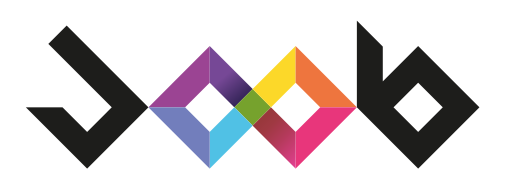
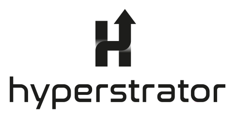

<picture>
  <source media="(prefers-color-scheme: dark)" srcset="assets/joob-logo-dark.svg">
  
</picture>

### Software House for Industry 4.0

Italian software house founded in 2020, focused on software for industrial automation.
We help industrial companies with their digital transformation, building platforms that integrate with complex production processes.

 

<picture>
  <source media="(prefers-color-scheme: dark)" srcset="assets/hyperstrator-logo-dark.svg">
  
</picture>

**Hyperstrator™** is our platform for supervision, control and data acquisition in production environments.

 

`SCADA` &nbsp; `HMI` &nbsp; `WMS` &nbsp; `WCS` &nbsp; `MES`

 

[Website](https://joob.srl) &nbsp;·&nbsp; [LinkedIn](https://www.linkedin.com/company/joob-s-r-l/) &nbsp;·&nbsp; [info@joob.srl](mailto:info@joob.srl)

